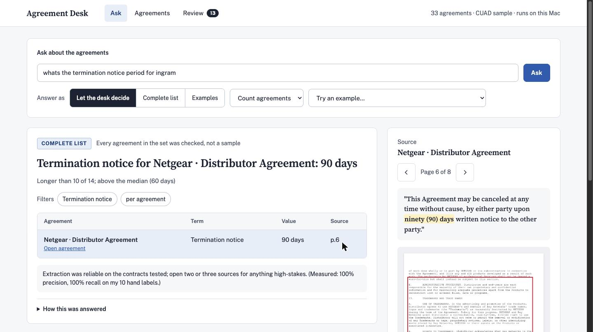
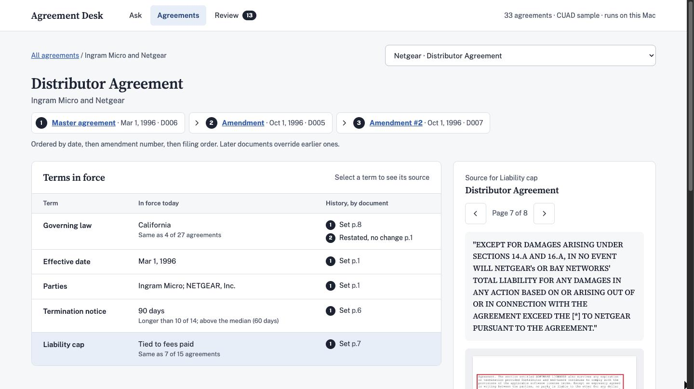
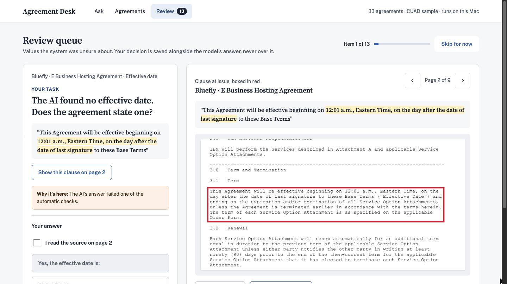
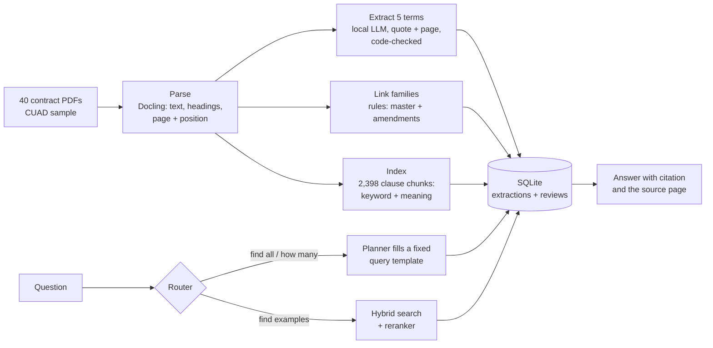

# Agreement Desk

A working prototype of a legal agreement search tool, built to learn how legal-tech infrastructure works end to end.
The core idea: **AI reads, databases count.** A local model reads each contract once and extracts key terms with
quotes and page numbers; questions that need a complete answer ("which agreements have no liability cap?") are then
counted from a database, and questions about wording ("who pays the lawyers if we fight?") are answered by search.
Every answer opens to the page it came from, with the cited text boxed.

Everything runs locally on a laptop. No contract leaves the machine.

| Ask | Agreement | Review |
| --- | --- | --- |
|  |  |  |

## How it works



1. **Parse:** Docling turns each PDF into text with headings, page numbers and the position of every paragraph.
2. **Link:** rules (not AI) group each amendment with the agreement it changes, and order them by date, then
   amendment number, then filing order.
3. **Extract:** a local model (qwen2.5:14b via Ollama) fills five fields per contract (parties, effective date,
   governing law, termination notice, liability cap), each with a quote and page. Code checks that the quote really
   appears on the page and normalizes the value.
4. **Index:** structure-aware chunks are searchable by keyword (SQLite FTS5, BM25) and by meaning (nomic-embed-text),
   merged with Reciprocal Rank Fusion and reranked with a cross-encoder (BGE reranker v2-m3).
5. **Answer:** a router decides between the complete-list desk and the search desk. For complete lists, the model
   only fills the blanks of a fixed query template; code validates the plan and builds the SQL.
6. **Review:** uncertain answers go to a review queue. Corrections are stored beside the model's answer, never over
   it, with an audit trail; every answer uses them immediately.

## What I measured

All numbers are from small sets, stated with their sample sizes.

| What | Result | Measured on |
| --- | --- | --- |
| Extraction: parties, effective date, termination notice | 100% precision and recall | 10 contracts I hand-labeled |
| Extraction: governing law | 86% / 86% | same 10 |
| Extraction: liability cap type | 80% precision, 67% recall | same 10 (the hardest field) |
| Extraction on unseen contracts: parties / governing law | 93% / 92% precision | 30-contract holdout, scored against CUAD's attorney-reviewed labels |
| Extraction on unseen contracts: effective date | 86% precision, 76% recall | same 30 |
| Search: hybrid + BGE reranker | 90% found something relevant in the top 5; 70% of the top 5 relevant | 40 plain-English questions, graded by an LLM judge |
| Search: hybrid without reranker | 82% / 51% | same 40 |
| LLM judge vs my labels | right on 21 of 23 disagreements with rule-based grading; 15 of 15 on a blind spot-check | 10 questions, 119 passages |
| Query planner | 15 of 15 regression tests | questions that previously broke it |
| API smoke test | 10 of 10 | known answers |

## What broke, and what I changed

- **Silent wrong answers were the main risk.** Three times the system confidently answered a question nobody asked:
  a dropped date range ("after 2000"), "how many amendments" answered as a governing-law count, and "agreements with
  an indemnification clause" answered as a liability-cap list. The fixes stack: check topic coverage before routing,
  warn when the plan is about a term the question never mentioned, and show the plan under every answer.
- **A confident zero is the most dangerous answer.** "No agreements with Bay Networks" read as "no contracts with
  them," but Bay Networks (Netgear's parent) appears in 6 passages. Empty party searches now say where the name appears.
- **My first search grader was biased.** Regex rules rewarded keyword search; an LLM judge (a different model family,
  calibrated against my labels first) showed meaning search was undercounted by more than 20 points.
- **The reranker was chosen by a bake-off, not a leaderboard.** A small web-trained model added nothing; BGE added
  about 19 points of precision on my questions, with one regression kept on the record.
- **Users name deals by counterparty, not by ID.** "Termination notice for Ingram" was refused because the query
  needed "D006". It now resolves the counterparty to the agreement and refuses rather than guesses when several match.
- **I cut a feature I built.** A benchmarks page turned into one line per term ("longer than 10 of 14; above the
  median"), because "is this normal?" is asked while reading a term, and 40 contracts are too few for a page.

## What production would add

An entity table for parent companies and former names; a clause-inventory classifier trained on CUAD's 41 labeled
clause types; query rewriting into contract vocabulary; permission-aware retrieval; a client perspective ("our cap"
vs "their cap"); gold sets from two attorneys; and query logs to measure citation click-through and override rates.

## Run it

Needs macOS or Linux, [uv](https://docs.astral.sh/uv/) and [Ollama](https://ollama.com).

```
ollama pull qwen2.5:14b
ollama pull nomic-embed-text
uv sync
uv run uvicorn api:app --port 8000       # custom front end: http://localhost:8000
uv run streamlit run app.py              # or the Streamlit version
```

The parsed contracts, extractions and index are included, so the app runs without reprocessing. The raw PDFs come
from CUAD (below) and go in `data/raw/`.

Tests: `uv run python scripts/08_api_smoke.py` (with the server running), `uv run python scripts/06f_plan_tests.py`,
`uv run python scripts/06e_search_eval.py`.

## How it was built

Pair-built with Claude as a learning project. I scoped it, made the product and design decisions, labeled the
evaluation data, ran every step and checked the results; Claude wrote most of the code and explained each piece.

## Data and attribution

This repository includes contracts and content derived from them (parsed text, extracted fields, quotes, page images)
from **CUAD v1**, the Contract Understanding Atticus Dataset, by The Atticus Project.

- Source: https://www.atticusprojectai.org/cuad (downloaded from https://huggingface.co/datasets/theatticusproject/cuad)
- License: CC BY 4.0, https://creativecommons.org/licenses/by/4.0/
- Paper: Hendrycks, Burns, Chen and Ball, "CUAD: An Expert-Annotated NLP Dataset for Legal Contract Review",
  NeurIPS 2021 Datasets and Benchmarks Track. https://arxiv.org/abs/2103.06268

Changes made: a 40-contract sample was selected; contracts were parsed with Docling, grouped into agreement
families, and run through local-model field extraction. The gold labels in `data/labels/` are this project's own hand
labels, not CUAD's annotations.
